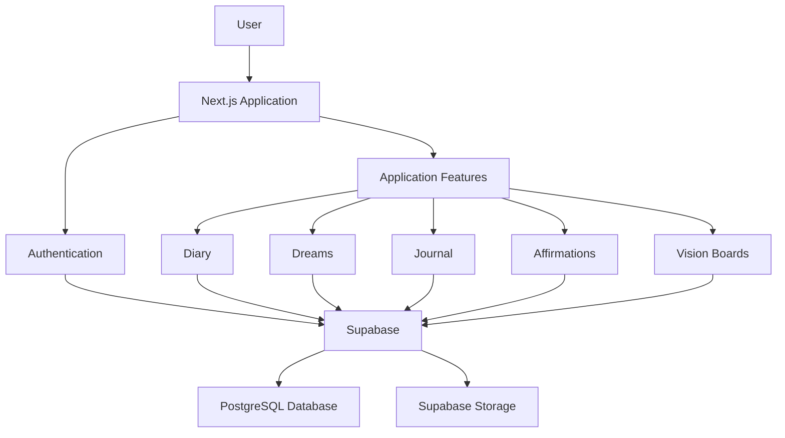

# ✨ Our Little Universe

> A little space to dream, reflect, manifest, and become.

**Our Little Universe** is a personal digital sanctuary designed to help you reconnect with yourself, document your journey, and intentionally create the life you envision.

From journaling your thoughts and recording your dreams to creating vision boards and practicing affirmations, the app brings your inner world into one cozy, private space.

---

## 🌙 About

We often have dreams, intentions, thoughts, and little moments we want to remember — but they end up scattered across notes, journals, and our minds.

Our Little Universe brings them together into one place.

It isn't about becoming someone else overnight. It's about creating space to reflect, visualize the future, appreciate the present, and slowly become the person you're meant to be.

## ✨ Features

- **📔 Diary** — Write daily entries, record manifestations, express gratitude, capture feelings, and attach photographs to memories.
- **🌙 Dreams** — Record dreams, preserve the details, and revisit your dream journal.
- **📝 Journal** — Guided journaling with daily prompts to encourage self-reflection and mindful writing.
- **💫 Affirmations** — Create and revisit affirmations that align with your intentions and mindset.
- **🖼️ Vision Boards** — Build visual representations of your goals, dreams, and the future you're working toward.
- **☁️ Cloud Storage** — Securely store your personal entries and uploaded photographs with Supabase.
- **🔐 Personal Space** — User-authenticated data, designed to keep your personal universe private.

## 🎨 Design Philosophy

The experience is inspired by:

- Scrapbooks and handwritten journals
- Warm paper textures and soft colors
- Nostalgia, creativity, and personal memories
- Minimal, distraction-free interfaces
- A feeling of having your own little corner of the universe

The goal is to make self-reflection feel less like a task and more like coming home to yourself.

## 🛠️ Tech Stack

| Technology | Purpose |
|---|---|
| Next.js | Full-stack application framework |
| React | Component-based UI |
| TypeScript | Type safety |
| Tailwind CSS | Styling and responsive design |
| Supabase | Authentication, database, and storage |
| PostgreSQL | Persistent application data |
| Supabase Storage | Photo storage |
| Vercel | Deployment |

## 🏗️ Architecture



## 🚀 Getting Started

### Prerequisites

- Node.js
- npm
- A Supabase project

### Installation

Clone the repository:

```bash
git clone <your-repository-url>
cd dreams
```

Install dependencies:

```bash
npm install
```

Create a `.env.local` file in the root directory:

```env
NEXT_PUBLIC_SUPABASE_URL=your_supabase_project_url
NEXT_PUBLIC_SUPABASE_ANON_KEY=your_supabase_anon_key
```

Configure your Supabase database and storage buckets according to the application requirements.

Start the development server:

```bash
npm run dev
```

Open [http://localhost:3000](http://localhost:3000) in your browser.

### Production Build

Check the application before deployment:

```bash
npm run build
```

Run the production server:

```bash
npm run start
```

## 📂 Project Structure

```text
.
├── app/
│   ├── (app)/             # Main authenticated application
│   │   ├── diary/         # Diary and entries
│   │   ├── dreams/        # Dream journal
│   │   ├── journal/       # Guided journaling
│   │   ├── affirmations/  # Affirmation space
│   │   └── vision-board/  # Vision boards
│   └── ...
├── components/             # Reusable UI components
├── lib/                   # Utilities and Supabase helpers
├── public/                 # Static assets
├── ...
```

*Structure may evolve as new features are added.*

## 🔒 Privacy

Personal writing deserves privacy.

Our Little Universe is designed around authenticated accounts and user-specific data access. Database access policies and storage permissions are used to protect personal entries and uploaded media.

Never commit credentials, private API keys, or environment files to version control.

## 🪐 The Idea

A universe doesn't come into existence all at once.

Neither does the life you dream of.

Every thought you write down, every little thing you're grateful for, every intention you set, and every step you take becomes part of something bigger.

This is your universe.

Build it slowly. Make it yours.

---

<p align="center">
  Made with ♡, dreams, and a little bit of magic.
</p>
