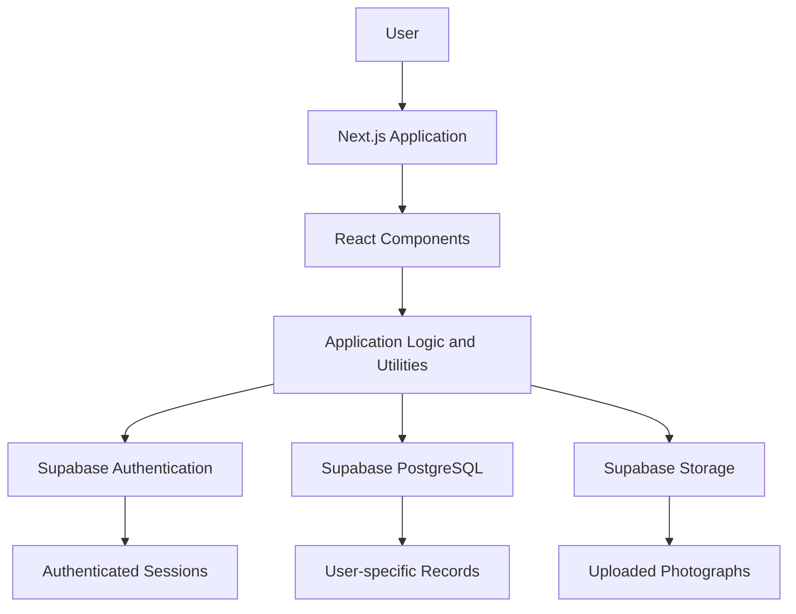

# Dear, Someday!

> A personal space for reflection, visualization, and intentional growth.

**Dear, Someday** is a personal journaling and self-development platform designed to help individuals document their thoughts, organize their aspirations, practice self-reflection, and visualize their long-term goals.

The platform brings together journaling, dream tracking, affirmations, gratitude, and vision boards in a unified digital environment. It provides a structured yet personal space to reflect on the present, preserve meaningful experiences, and work towards future aspirations.

---

## About the Project

Personal goals, reflections, and aspirations are often scattered across multiple applications, notebooks, and digital platforms. Maintaining a consistent practice of self-reflection and tracking personal progress can therefore become difficult.

"Dear, Someday" addresses this by providing a centralized platform for documenting personal experiences, recording dreams, maintaining affirmations, and creating visual representations of individual goals.

The application focuses on intentional living, self-awareness, and personal development through accessible digital tools and a distraction-free user experience.

## Features

- **Diary:** Create and manage daily diary entries, document manifestations, record gratitude, express emotions, and attach photographs to preserve personal memories.
- **Dream Journal:** Record dreams, maintain a history of entries, and revisit previously documented experiences.
- **Guided Journaling:** Use structured prompts to encourage introspection, self-awareness, and consistent journaling practices.
- **Affirmations:** Create, organize, and revisit personalized affirmations that reinforce individual goals and intentions.
- **Vision Boards:** Create visual collections representing personal aspirations, milestones, and long-term objectives.
- **Cloud-Based Persistence:** Store diary entries and associated photographs using Supabase database and storage services.
- **Authentication and Data Privacy:** Provide authenticated access and user-specific data management to maintain separation between individual accounts.

## Design Philosophy

The interface is designed around the following principles:

- **Simplicity:** Minimal and intuitive layouts that prioritize content over unnecessary interface elements.
- **Personalization:** Flexible spaces that allow users to express their thoughts and aspirations in their own way.
- **Visual Consistency:** A cohesive design language inspired by traditional journals, scrapbooks, and archival aesthetics.
- **Accessibility:** Responsive layouts and straightforward interactions across different screen sizes.
- **Focused Experience:** A distraction-free environment that encourages reflection and meaningful engagement.

The objective is to make personal documentation and reflection an accessible, consistent part of everyday life.

## Technology Stack

| Technology | Purpose |
|---|---|
| Next.js | Full-stack application framework |
| React | Component-based user interface |
| TypeScript | Static typing and maintainable application code |
| Tailwind CSS | Utility-first styling and responsive layouts |
| Supabase Auth | User authentication and session management |
| Supabase PostgreSQL | Persistent storage of application data |
| Supabase Storage | Storage and retrieval of uploaded photographs |
| Vercel | Application deployment and hosting |

## Architecture

The application follows a modular architecture in which the presentation layer, application logic, authentication, and persistent storage are separated.



## Getting Started

### Prerequisites

Ensure that the following are installed or configured:

- Node.js (LTS recommended)
- npm
- Git
- A Supabase project

### Installation

**1. Clone the repository**

```bash
git clone <your-repository-url>
cd <project-directory>
```

**2. Install dependencies**

```bash
npm install
```

**3. Configure environment variables**

Create a `.env.local` file in the project root:

```env
NEXT_PUBLIC_SUPABASE_URL=your_supabase_project_url
NEXT_PUBLIC_SUPABASE_ANON_KEY=your_supabase_anon_key
```

Use the appropriate public client key for your Supabase project. Never expose service-role credentials in client-side code.

**4. Configure Supabase**

Set up the required database tables, authentication configuration, Row Level Security (RLS) policies, and storage buckets according to the application's implementation.

**5. Start the development server**

```bash
npm run dev
```

Open [http://localhost:3000](http://localhost:3000) to access the application.

### Production Build

To verify the application before deployment:

```bash
npm run build
```

To run the production build locally:

```bash
npm run start
```

## Project Structure

```text
.
├── app/
│   ├── (app)/
│   │   ├── diary/
│   │   ├── dreams/
│   │   ├── journal/
│   │   ├── affirmations/
│   │   └── vision-board/
│   └── ...
│
├── components/
│   └── scrapbook/
│
├── lib/
│   ├── supabase/
│   └── ...
│
├── public/
├── .env.local
├── package.json
├── tsconfig.json
└── README.md
```

*The directory structure is representative and may evolve as the application develops.*

## Data Management and Privacy

Privacy is an important consideration for an application that handles personal reflections and journal entries.

The application uses Supabase authentication to associate data with individual user accounts. PostgreSQL stores structured application records, while Supabase Storage manages uploaded photographs.

The intended data-management approach includes:

- Authenticated access to personal records.
- User-specific database queries.
- Row Level Security policies for database-level access control.
- Storage policies governing access to private photographs.
- Signed URLs for retrieving protected media.
- Environment variables for managing application configuration.

Users should never commit credentials, private keys, or environment files to version control.

## Future Scope

Potential areas of development include:

- Advanced journaling prompts and personalization.
- Calendar-based reflection and activity tracking.
- Improved search and filtering across journal entries.
- Personal progress summaries and insights.
- Additional customization options for vision boards.
- Export and backup functionality for personal records.

## Project Vision

"Dear, Someday" is built around the idea that personal growth benefits from reflection, consistency, and clarity of intention.

By bringing journaling, visualization, gratitude, and personal goal tracking into one platform, the project aims to provide a practical digital environment for individuals to document their experiences and remain connected to their aspirations.

---

**Our Little Universe**  
*A personal platform for reflection, visualization, and growth.*